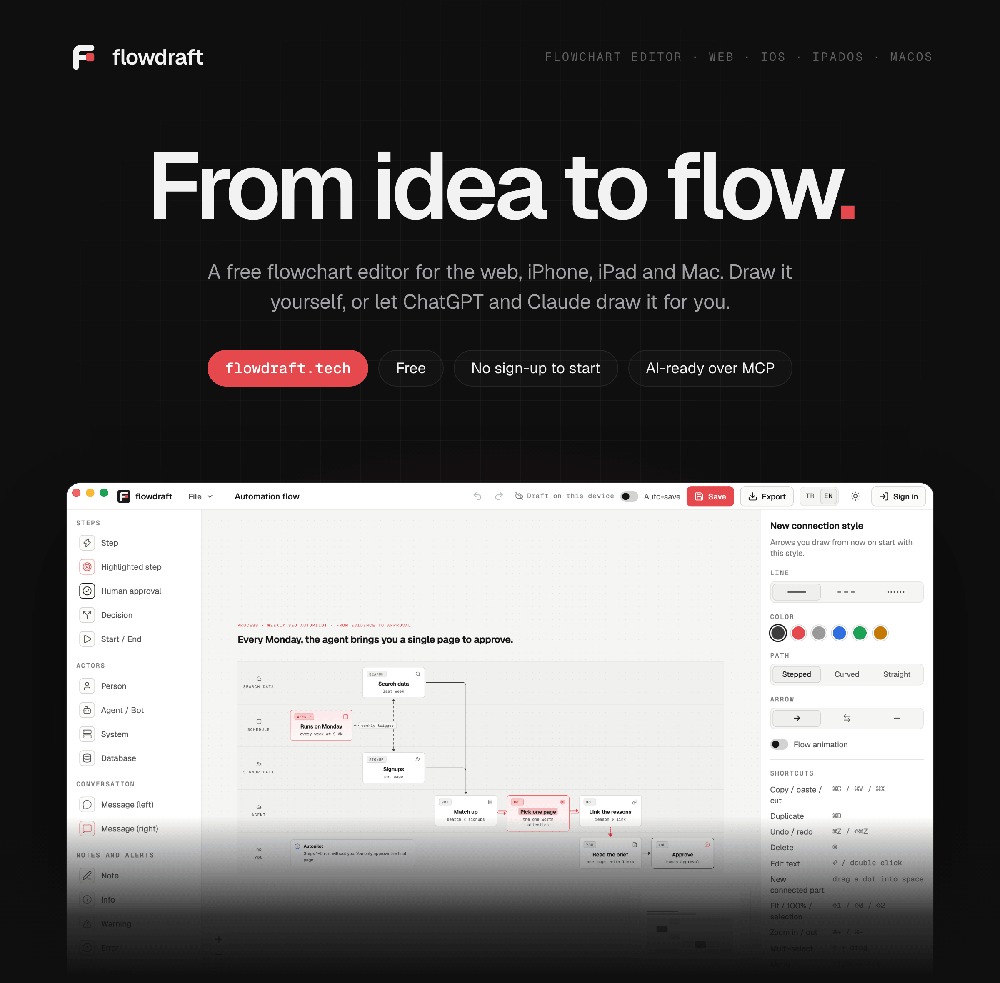
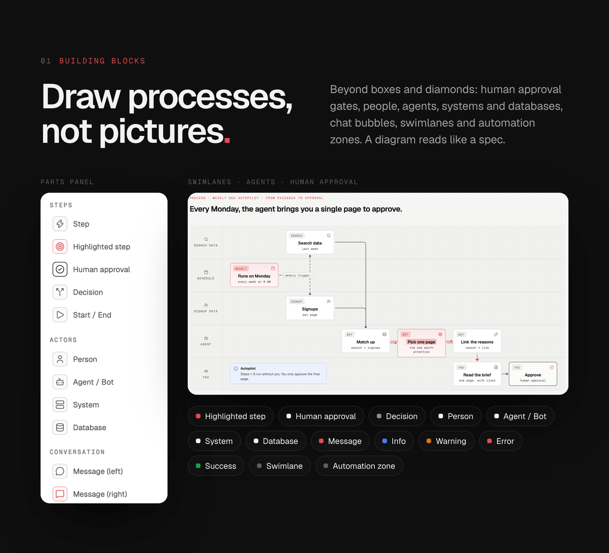
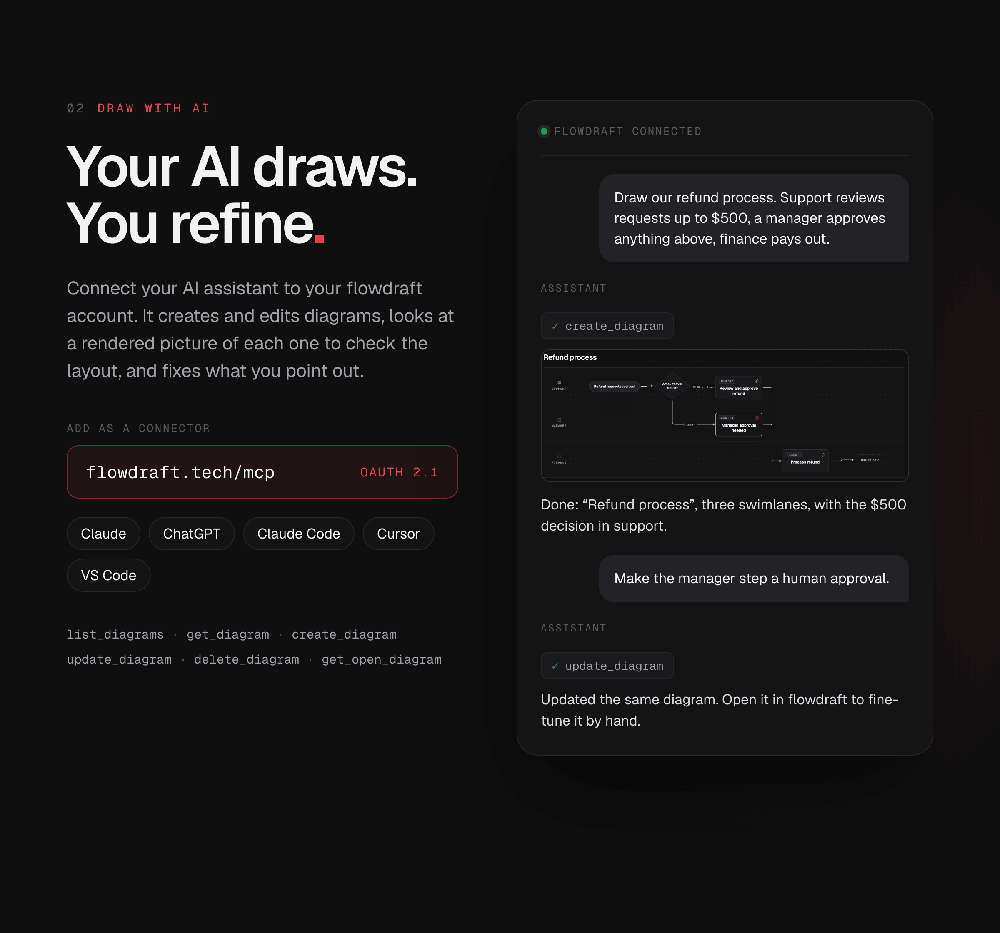
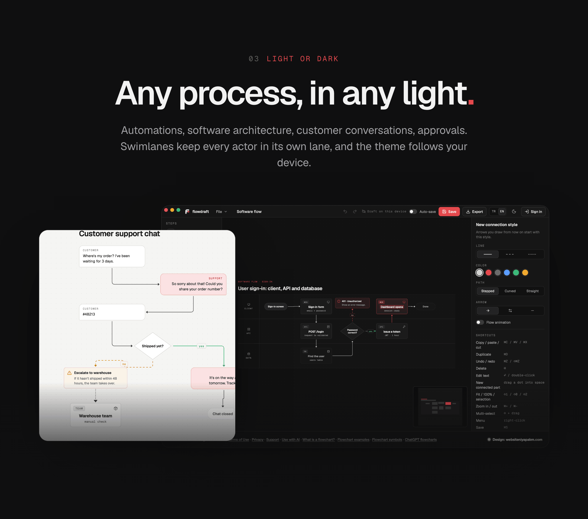
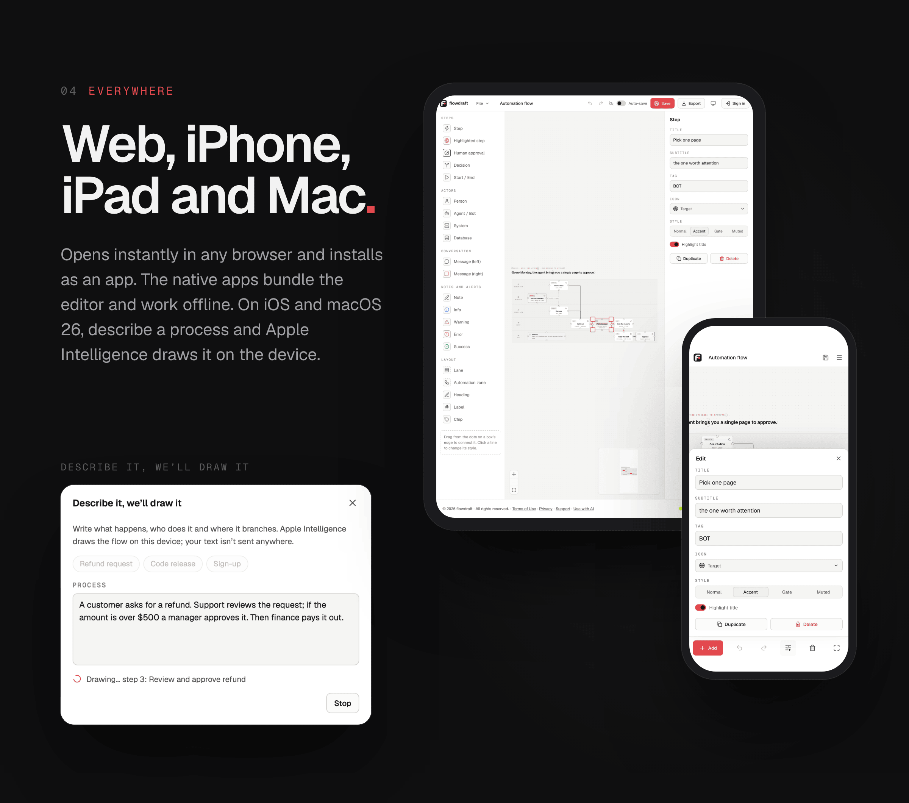
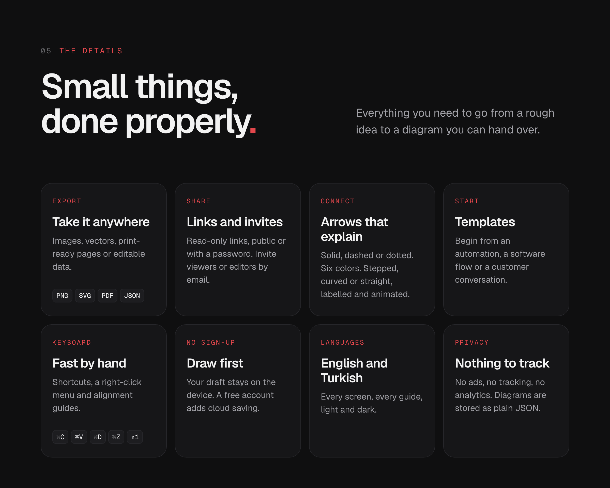
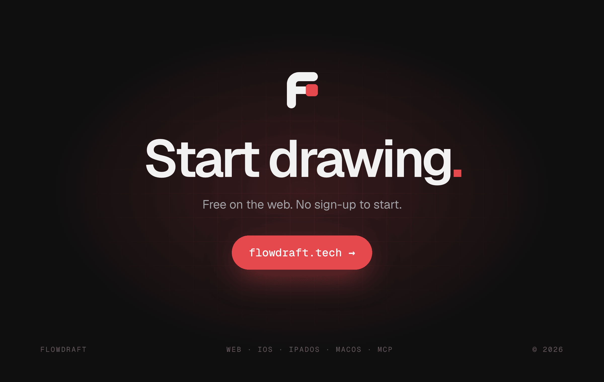

<div align="center">
<a href="https://flowdraft.tech"></a>

<a href="https://flowdraft.tech/mcp"></a>



<a href="https://flowdraft.tech"></a>
</div>

<br>

<div align="center">

**[Open the editor](https://flowdraft.tech)** · [Product tour](https://flowdraft.tech/tanitim?lang=en) · [Connect your AI](https://flowdraft.tech/mcp) · [What is a flowchart?](https://flowdraft.tech/what-is-a-flowchart) · [Flowchart examples](https://flowdraft.tech/flowchart-examples)

</div>

## Connect your AI assistant

Add **`https://flowdraft.tech/mcp`** as a connector (MCP server) and sign in with your flowdraft account. Sign-in is OAuth 2.1 with dynamic client registration, so there are no API keys to copy, and every query runs with your own token under row-level security. Setup guides for each client: [flowdraft.tech/mcp](https://flowdraft.tech/mcp).

| Tool | What it does |
| --- | --- |
| `list_diagrams` | Lists the diagrams in your account |
| `get_diagram` | Reads a diagram as JSON, with a rendered PNG |
| `create_diagram` | Creates a diagram and returns its link and picture |
| `update_diagram` | Replaces a diagram's nodes and edges |
| `delete_diagram` | Deletes a diagram |
| `get_open_diagram` | Reads the flow open in your editor, unsaved changes included (opt-in) |

## Under the hood

| | |
| --- | --- |
| **Editor** | React 19, TypeScript, [React Flow](https://reactflow.dev), Zustand, Vite |
| **Server** | Node 22, Express 5, MCP SDK; diagrams rendered to PNG with resvg and the Geist fonts |
| **Data** | Supabase: Postgres with row-level security, Auth with its OAuth 2.1 server (self-hosted) |
| **Apps** | SwiftUI + WKWebView for iPhone, iPad and Mac (Catalyst), Foundation Models on device |

```bash
cp .env.example .env   # SUPABASE_URL and SUPABASE_ANON_KEY
npm install
npm run dev            # http://localhost:5173
```

Production build, database migrations, Docker/Coolify and the OAuth setup for the MCP server: **[docs/self-hosting.md](docs/self-hosting.md)**.

## License

© 2026 flowdraft. All rights reserved. The source is public so you can see how flowdraft works; it is not licensed for reuse or redistribution. The bundled Geist fonts are under the SIL Open Font License (`server/fonts/OFL.txt`).
