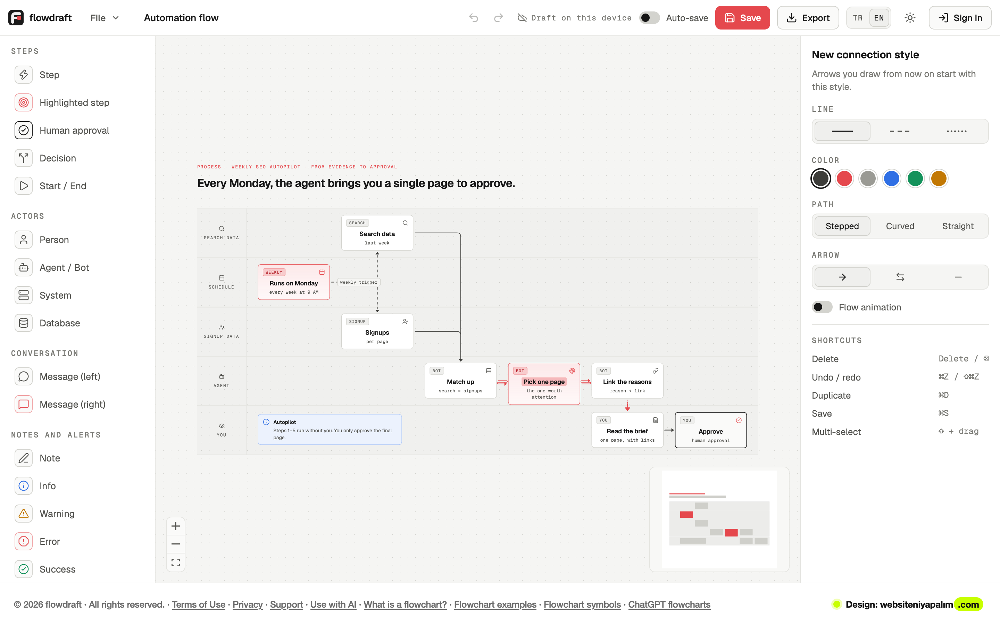
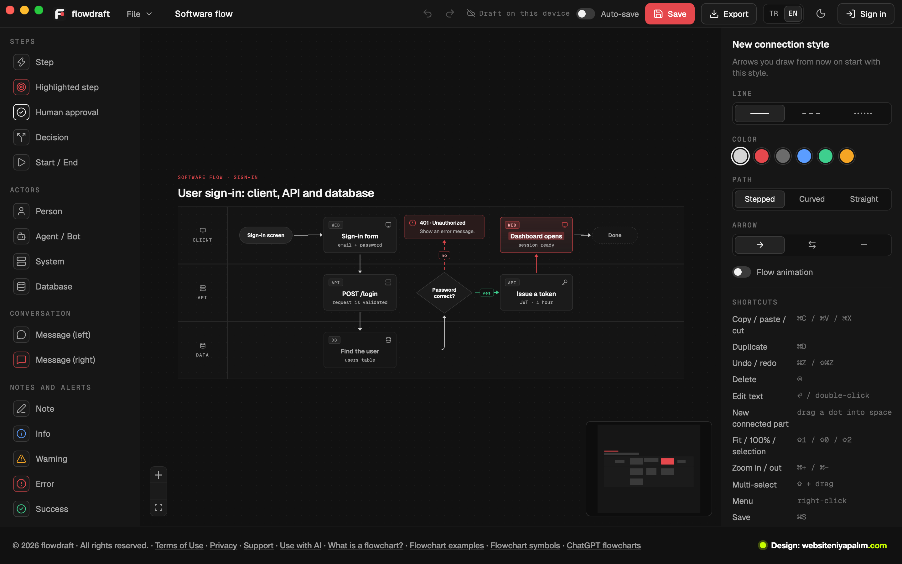
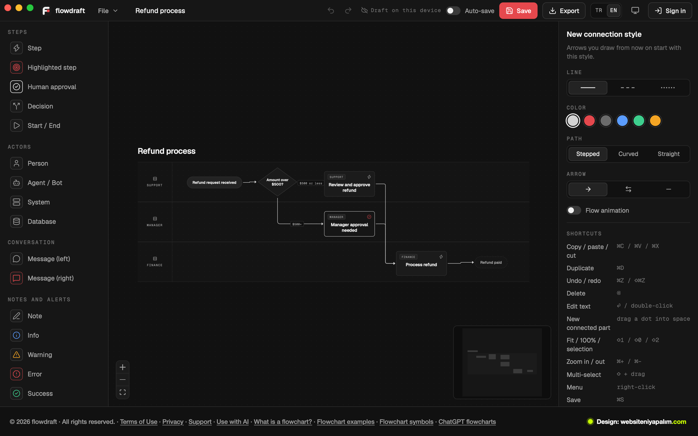

<div align="center">

<a href="https://flowdraft.tech">
  <picture>
    <source media="(prefers-color-scheme: dark)" srcset="icons/logo/logo-on-dark.svg">
    
  </picture>
</a>

### From idea to flow.

A free flowchart editor for the web, iPhone, iPad and Mac.<br>
Draw a process by hand, or let ChatGPT or Claude draw it for you over MCP.

[**Open the editor**](https://flowdraft.tech) · [Product tour](https://flowdraft.tech/tanitim?lang=en) · [Connect your AI](https://flowdraft.tech/mcp) · [Guides](https://flowdraft.tech/what-is-a-flowchart) · [Türkçe](README.tr.md)

[](https://flowdraft.tech)
[](https://flowdraft.tech/mcp)


<br>



</div>

## Why flowdraft

**Start drawing in a second.** The editor opens instantly in any browser. No install, no sign-up: your drawing is kept on the device as a draft. A free account adds cloud saving, auto-save and export on the web; the native apps export without one.

**Parts that mean something.** Beyond boxes and diamonds, flowdraft has a human-approval gate, person, agent/bot, system and database actors, chat bubbles, swimlanes and automation zones. A diagram reads like a process spec, not a picture.

**Built for working with AI.** Connect ChatGPT, Claude, Claude Code, Cursor or VS Code to your account. The assistant creates and edits diagrams, gets a rendered picture back to check its own layout, and fixes what you point out. You polish the result by hand.

<table>
  <tr>
    <td width="50%"></td>
    <td width="50%"></td>
  </tr>
  <tr>
    <td align="center"><sub>Software flows in swimlanes, light and dark theme</sub></td>
    <td align="center"><sub>Describe a process, get an editable flowchart</sub></td>
  </tr>
</table>

## Features

| | |
| --- | --- |
| **Building blocks** | Step, highlighted step, human approval, decision, start/end, person, agent/bot, system, database, message (left/right), note, info, warning, error, success, swimlane, automation zone, heading, chip |
| **Connections** | Solid, dashed or dotted · 6 colors · stepped, curved or straight paths · arrow direction · flow animation · labels |
| **Editing** | Text edited right on the canvas · drag from a handle into empty space to add a connected part · copy, cut and paste across flows · undo/redo · multi-select · alignment guides · right-click menu · keyboard shortcuts |
| **Templates** | Automation, software and conversation flows to start from |
| **Export** | PNG image, SVG vector, PDF (A4 or A3), editable JSON · JSON import |
| **Sharing** | Read-only links (`/s/<token>`), public or password-protected · invite people by email as viewers or editors (web) |
| **Everywhere** | Desktop, tablet and phone browsers · installable PWA · native iPhone, iPad and Mac app |
| **Languages** | English and Turkish · light and dark theme |
| **Privacy** | No ads, no tracking, no analytics. Diagrams are stored as node and edge JSON only |

## Draw with your AI assistant

Add **`https://flowdraft.tech/mcp`** as a connector or MCP server in your AI tool and sign in with your flowdraft account. Step-by-step setup for Claude, ChatGPT, Claude Code, Cursor and VS Code is at [flowdraft.tech/mcp](https://flowdraft.tech/mcp).

```text
You:    Draw our refund process: support reviews requests under $500,
        a manager approves anything above, finance pays out.
Claude: Created "Refund process" with three swimlanes. Here is the picture.
You:    Mark the manager step as a human approval and make the happy path green.
Claude: Updated. https://flowdraft.tech/?p=…
```

| Tool | What it does |
| --- | --- |
| `list_diagrams` | Lists the diagrams in your account |
| `get_diagram` | Reads a diagram as JSON, with a rendered PNG |
| `create_diagram` | Creates a diagram and returns its link and picture |
| `update_diagram` | Replaces a diagram's nodes and edges |
| `delete_diagram` | Deletes a diagram |
| `get_open_diagram` | Reads the flow open in your editor right now, unsaved changes included (opt-in) |

Sign-in uses OAuth 2.1 with dynamic client registration, so no API keys are copied around. Every query runs with your own token under row-level security. Pictures are rendered on the server (SVG → PNG with resvg), and clients that support MCP Apps show them right in the chat.

## Native apps

The `ios/` folder holds the iPhone, iPad and Mac (Mac Catalyst) app: a SwiftUI shell around the bundled web editor that works offline, with share-sheet and save-panel export, file import and a real menu bar. On iOS and macOS 26 it can also **draw from a description** with Apple's on-device model (Foundation Models): no server, no account. The apps are on their way to the App Store.

## Built with

| Layer | Stack |
| --- | --- |
| Editor | React 19, TypeScript, [React Flow](https://reactflow.dev) (`@xyflow/react`), Zustand, Vite |
| Server | Node 22, Express 5: static files, SEO pages, runtime config, the MCP endpoint |
| AI | `@modelcontextprotocol/sdk`, zod; diagram rendering with `@resvg/resvg-js`, `opentype.js` and the Geist fonts |
| Data and auth | Supabase (Postgres with row-level security, Auth with its OAuth 2.1 server), self-hosted |
| Apple platforms | SwiftUI + WKWebView, XcodeGen, Foundation Models |
| Hosting | Docker on Coolify |

## Getting started

Requires Node.js 22+ and a Supabase project.

```bash
cp .env.example .env   # fill in SUPABASE_URL and SUPABASE_ANON_KEY
npm install
npm run dev            # http://localhost:5173
```

Production build:

```bash
npm run build
SUPABASE_URL=... SUPABASE_ANON_KEY=... npm start   # http://localhost:3000
```

Database migrations, the Docker/Coolify setup and the OAuth configuration that the MCP server needs are covered in **[docs/self-hosting.md](docs/self-hosting.md)**.

## Project layout

```text
src/            web editor (flow model, components, stores, sharing, profile, admin, OAuth consent)
server/         MCP server, server-side diagram renderer, MCP Apps view
server.js       Express entry: static files, SPA fallback, /config.js, /mcp, security headers
seo.js, seo/    server-rendered landing page and guides (English and Turkish)
supabase/       SQL migrations (tables, RLS, sharing, admin)
ios/            iPhone, iPad and Mac app
icons/          logo and icon set
```

## License

© 2026 flowdraft. All rights reserved. The source is public so you can see how flowdraft works; it is not licensed for reuse or redistribution. The bundled Geist fonts are under the SIL Open Font License (`server/fonts/OFL.txt`).

<div align="center">
<br>
<a href="https://flowdraft.tech"><b>flowdraft.tech</b></a> · <a href="https://flowdraft.tech/destek?lang=en">Support</a> · <a href="https://flowdraft.tech/gizlilik?lang=en">Privacy</a> · <a href="https://flowdraft.tech/kullanim-sartlari?lang=en">Terms</a>
</div>
