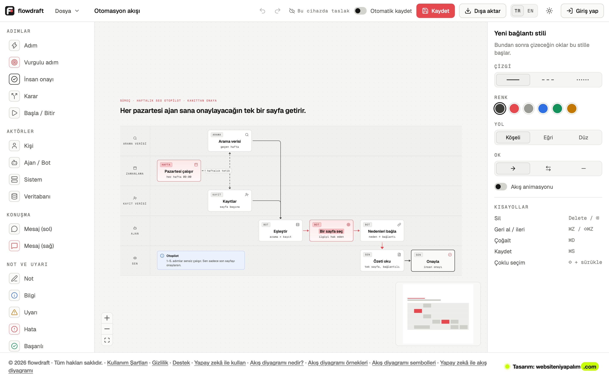
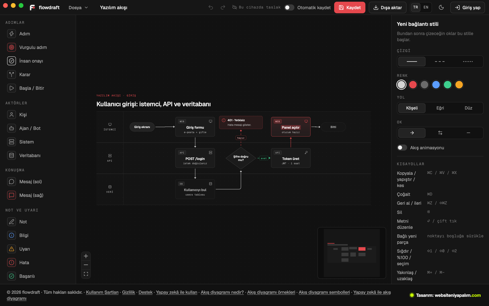
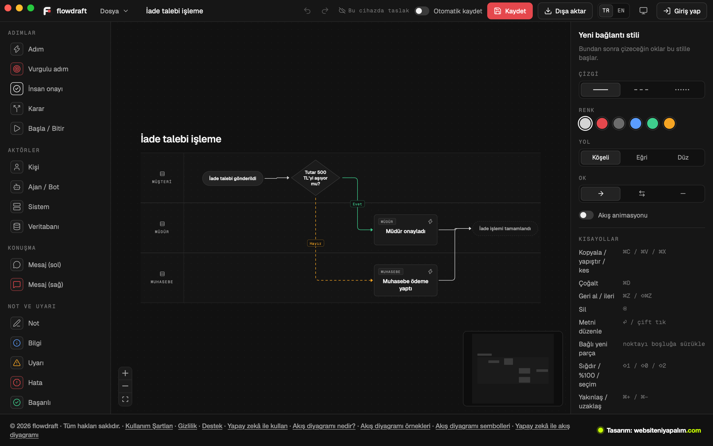

<div align="center">

<a href="https://flowdraft.tech">
  <picture>
    <source media="(prefers-color-scheme: dark)" srcset="icons/logo/logo-on-dark.svg">
    
  </picture>
</a>

### Fikirden akışa.

Web, iPhone, iPad ve Mac için ücretsiz akış diyagramı editörü.<br>
Süreci elle çiz ya da ChatGPT veya Claude'a MCP üzerinden çizdir.

[**Editörü aç**](https://flowdraft.tech) · [Tanıtım](https://flowdraft.tech/tanitim) · [AI aracını bağla](https://flowdraft.tech/mcp?lang=tr) · [Rehberler](https://flowdraft.tech/akis-diyagrami) · [English](README.md)

[](https://flowdraft.tech)
[](https://flowdraft.tech/mcp?lang=tr)


<br>



</div>

## Neden flowdraft

**Bir saniyede çizmeye başla.** Editör her tarayıcıda anında açılır. Kurulum yok, kayıt yok: çizimin bu cihazda taslak olarak saklanır. Ücretsiz hesap webde buluta kaydetme, otomatik kaydetme ve dışa aktarma ekler; uygulamalar hesapsız dışa aktarır.

**Anlam taşıyan parçalar.** Kutu ve eşkenar dörtgenin ötesinde insan onayı, kişi, ajan/bot, sistem ve veritabanı aktörleri, konuşma balonları, kulvarlar ve otomasyon bölgeleri var. Diyagram bir resim değil, süreç tanımı gibi okunur.

**AI ile çalışmak için yapıldı.** ChatGPT, Claude, Claude Code, Cursor ya da VS Code'u hesabına bağla. Asistan diyagram oluşturur ve düzenler, çizdiğinin resmini görüp yerleşimini kontrol eder, söylediğin düzeltmeyi yapar. Sonra sen elle rötuşlarsın.

<table>
  <tr>
    <td width="50%"></td>
    <td width="50%"></td>
  </tr>
  <tr>
    <td align="center"><sub>Kulvarlarda yazılım akışları, açık ve koyu tema</sub></td>
    <td align="center"><sub>Süreci anlat, düzenlenebilir akış diyagramı al</sub></td>
  </tr>
</table>

## Özellikler

| | |
| --- | --- |
| **Parçalar** | Adım, vurgulu adım, insan onayı, karar, başla/bitir, kişi, ajan/bot, sistem, veritabanı, mesaj (sol/sağ), not, bilgi, uyarı, hata, başarılı, kulvar, otomatik bölge, başlık, çip |
| **Bağlantılar** | Düz, kesikli ya da noktalı · 6 renk · köşeli, eğri ya da düz yol · ok yönü · akış animasyonu · etiket |
| **Düzenleme** | Yazı doğrudan tuvalde düzenlenir · bağlantı noktasından boşluğa sürükleyince bağlı yeni parça · akışlar arası kopyala, kes, yapıştır · geri al/ileri al · çoklu seçim · hizalama kılavuzları · sağ tık menüsü · klavye kısayolları |
| **Şablonlar** | Otomasyon, yazılım ve konuşma akışları |
| **Dışa aktarma** | PNG görsel, SVG vektör, PDF (A4 ya da A3), düzenlenebilir JSON · JSON içe aktarma |
| **Paylaşım** | Salt okunur linkler (`/s/<token>`), herkese açık ya da şifreli · e-postayla kişi ekleme, izleyici ya da düzenleyici olarak (web) |
| **Her yerde** | Masaüstü, tablet ve telefon tarayıcıları · ana ekrana eklenebilir PWA · iPhone, iPad ve Mac uygulaması |
| **Dil** | Türkçe ve İngilizce · açık ve koyu tema |
| **Gizlilik** | Reklam yok, izleme yok, analitik yok. Diyagramlar yalnızca düğüm ve bağlantı JSON'u olarak saklanır |

## AI asistanınla çiz

AI aracına **`https://flowdraft.tech/mcp`** adresini bağlayıcı ya da MCP sunucusu olarak ekle ve flowdraft hesabınla giriş yap. Claude, ChatGPT, Claude Code, Cursor ve VS Code için adım adım kurulum: [flowdraft.tech/mcp](https://flowdraft.tech/mcp?lang=tr).

```text
Sen:    İade sürecimizi çiz: 500 TL altını destek ekibi onaylasın,
        üstünü müdür onaylasın, ödemeyi finans yapsın.
Claude: Üç kulvarlı "İade süreci" akışını oluşturdum. Resmi burada.
Sen:    Müdür adımını insan onayı yap, ana yolu yeşil çiz.
Claude: Güncelledim. https://flowdraft.tech/?p=…
```

| Araç | Ne yapar |
| --- | --- |
| `list_diagrams` | Hesabındaki akışları listeler |
| `get_diagram` | Bir akışı JSON olarak, PNG resmiyle birlikte okur |
| `create_diagram` | Akış oluşturur, linkini ve resmini döndürür |
| `update_diagram` | Akışın düğümlerini ve bağlantılarını yeniler |
| `delete_diagram` | Akışı siler |
| `get_open_diagram` | Editörde şu an açık akışı, kaydedilmemiş değişikliklerle okur (isteğe bağlı) |

Giriş, dinamik istemci kaydıyla OAuth 2.1 üzerinden yapılır; API anahtarı kopyalamak gerekmez. Her sorgu senin token'ınla, satır düzeyi güvenlik altında çalışır. Resimler sunucuda çizilir (SVG → PNG, resvg) ve MCP Apps destekleyen istemciler onları doğrudan sohbette gösterir.

## Uygulamalar

`ios/` klasörü iPhone, iPad ve Mac (Mac Catalyst) uygulamasıdır: paketlenmiş web editörünü çevrimdışı çalıştıran bir SwiftUI kabuğu; paylaşım menüsü ve kaydetme penceresiyle dışa aktarma, dosya içe aktarma ve gerçek bir menü çubuğu. iOS ve macOS 26'da Apple'ın cihaz üstü modeliyle (Foundation Models) **anlatarak çizer**: sunucu da hesap da gerekmez. Uygulamalar App Store yolunda.

## Kullanılan teknolojiler

| Katman | Teknoloji |
| --- | --- |
| Editör | React 19, TypeScript, [React Flow](https://reactflow.dev) (`@xyflow/react`), Zustand, Vite |
| Sunucu | Node 22, Express 5: statik dosyalar, SEO sayfaları, çalışma anı ayarları, MCP uç noktası |
| AI | `@modelcontextprotocol/sdk`, zod; diyagram çizimi için `@resvg/resvg-js`, `opentype.js` ve Geist fontları |
| Veri ve kimlik | Supabase (satır düzeyi güvenlikli Postgres, OAuth 2.1 sunuculu Auth), kendi sunucumuzda |
| Apple platformları | SwiftUI + WKWebView, XcodeGen, Foundation Models |
| Barındırma | Coolify üzerinde Docker |

## Başlarken

Node.js 22+ ve bir Supabase projesi gerekir.

```bash
cp .env.example .env   # SUPABASE_URL ve SUPABASE_ANON_KEY doldur
npm install
npm run dev            # http://localhost:5173
```

Üretim:

```bash
npm run build
SUPABASE_URL=... SUPABASE_ANON_KEY=... npm start   # http://localhost:3000
```

Veritabanı migration'ları, Docker/Coolify kurulumu ve MCP sunucusunun ihtiyaç duyduğu OAuth ayarları **[docs/self-hosting.md](docs/self-hosting.md)** dosyasında (İngilizce).

## Proje yapısı

```text
src/            web editörü (akış modeli, bileşenler, store'lar, paylaşım, profil, yönetim, OAuth onayı)
server/         MCP sunucusu, sunucuda diyagram çizici, MCP Apps görünümü
server.js       Express girişi: statik dosyalar, SPA fallback, /config.js, /mcp, güvenlik başlıkları
seo.js, seo/    sunucuda üretilen ana sayfa ve rehberler (Türkçe ve İngilizce)
supabase/       SQL migration'ları (tablolar, RLS, paylaşım, yönetim)
ios/            iPhone, iPad ve Mac uygulaması
icons/          logo ve ikon seti
```

## Lisans

© 2026 flowdraft. Tüm hakları saklıdır. Kaynak kod, flowdraft'ın nasıl çalıştığı görülebilsin diye açıktır; yeniden kullanım ya da dağıtım için lisanslanmamıştır. Paketteki Geist fontları SIL Open Font License altındadır (`server/fonts/OFL.txt`).

<div align="center">
<br>
<a href="https://flowdraft.tech"><b>flowdraft.tech</b></a> · <a href="https://flowdraft.tech/destek">Destek</a> · <a href="https://flowdraft.tech/gizlilik">Gizlilik</a> · <a href="https://flowdraft.tech/kullanim-sartlari">Kullanım şartları</a>
</div>
