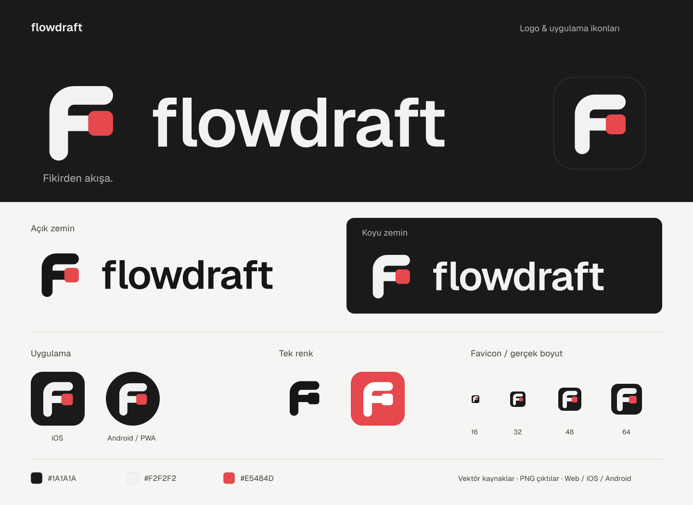

# Flowdraft — logo ve ikon seti



Akış bağlantısından oluşan **f** harfi ve kırmızı bitiş düğümü. Projenin antrasit, kırmızı ve Geist tipografisini sürdüren bir işaret.

Bu klasör bağımsız bir tasarım paketidir. Uygulamadaki mevcut logo ve ikonlar henüz bu setle değiştirilmedi.

## Dosyalar

| Klasör | İçerik |
| --- | --- |
| `logo/` | Yatay logo ve tek sembol. Açık/koyu zemin, siyah/beyaz tek renk. SVG + şeffaf PNG. |
| `favicon/` | SVG, 16/32/48/64 px PNG ve 16/32/48 px içeren ICO. 16 px çizimi küçük boyut için ayrıca ayarlandı. |
| `app/` | 1024 px ana ikon, 180 px Apple touch, 192/512 px PWA, 192/512 px maskable ikon; SVG kaynakları. |
| `ios/AppIcon.appiconset/` | 1024 px RGB PNG + Xcode `Contents.json`. |
| `android/` | 512 px mağaza ikonu, adaptive SVG kaynakları, yoğunluklara göre launcher/foreground/monochrome PNG ve Android kaynak XML dosyaları. |
| `source/` | Düzenlenebilir ana sembol, üretim betiği ve OFL lisanslı Geist yazı tipleri. |
| `preview.svg`, `preview.png` | Tüm seti gösteren sunum görseli. |

`on-light`: açık zeminde koyu logo. `on-dark`: koyu zeminde açık logo. `mono-black` ve `mono-white`: tek renk baskı ve özel zeminler. Logoların arka planı şeffaftır. SVG yazıları vektör yola çevrilmiştir; görüntülemek için font kurulumu gerekmez.

## Kullanım

- **Renkler:** antrasit `#1A1A1A`, beyaz `#F2F2F2`, kırmızı `#E5484D`. Açık zemindeki işaret/yazı `#161616`.
- Logoyu orantılı ölçekle. Çevresinde en az kırmızı düğümün genişliği kadar boşluk bırak.
- Küçük sekme ikonunda `favicon/` dosyalarını kullan. 16 px altına inme.
- iOS ana ikonu kare ve opaktır; köşeleri işletim sistemi uygular. Önizlemedeki yuvarlak köşe yalnızca kullanım örneğidir.
- PWA maskable sürümündeki işaret, merkezdeki %80 çaplı güvenli dairenin içinde kalır. Arka plan tam kare ve opaktır.
- Android adaptive katmanları 108 dp tuvali temel alır; işaret merkezdeki 66 dp çaplı güvenli alan içindedir. Android 13+ için ayrıca tek renk katman vardır. Önizlemedeki daire örnek bir sistem maskesidir.
- Klasik PNG/SVG ve Android kaynakları sağlanmıştır; Apple Icon Composer katmanlı dosyası bu pakete dahil değildir.

## Projeye uygulama noktaları

Bu adımlar seti uygulamaya bağlamak içindir; bu tasarım çalışmasında uygulanmadı.

- `favicon/` dosyalarını projenin `public/` klasörüne kopyala.
- `app/icon-192.png`, `app/icon-512.png`, `app/icon-maskable-512.png` ve `app/apple-touch-icon.png` dosyalarını aynı adlarla `public/` içine kopyala. Mevcut `public/manifest.webmanifest` bu adları zaten kullanıyor.
- `ios/AppIcon.appiconset/` içeriği mevcut `ios/Flowdraft/Assets.xcassets/AppIcon.appiconset/` için hazırlanmıştır.
- Yeni Android projesinde `android/res/` içeriğini uygulamanın `res/` klasörüne birleştir; manifestte `android:icon="@mipmap/ic_launcher"` kullan. Mevcut bir `colors.xml` varsa renk girdisini dosyanın içine ekle.
- Uygulama içindeki `src/components/TopBar.tsx` → `Logo` bileşeni eski sembolü satır içinde çiziyor; entegrasyonda onu da güncelle.
- Kök projedeki `scripts/icons.mjs` eski tasarımı üretir; bu paketle entegrasyon yapılırsa o betiği de uyarlamak gerekir.

## Yeniden üretim

`icons/` klasöründe Node.js 22+ ile:

```sh
npm ci
npm run build
```

Ana geometriyi `source/symbol.svg` üzerinden düzenle. Betik renk varyantlarını, fonttan bağımsız logoları, raster çıktıları, platform paketlerini ve önizlemeyi yalnızca bu klasöre yazar. Mikro favicon çizimi 16 px için betikte ayrı tutulur; sembol değiştiğinde onu da eşleştir.

Fontlar projenin `@fontsource-variable/geist` paketinden alınarak TTF biçimine dönüştürüldü; Latin ve Latin Extended alt kümeleri dahil. Lisans: `source/Geist-LICENSE.txt`.

Platform referansları: [Web maskable ikonlar](https://web.dev/articles/maskable-icon), [Apple uygulama ikonları](https://developer.apple.com/design/human-interface-guidelines/app-icons), [Android adaptive ikonlar](https://developer.android.com/develop/ui/compose/system/icon_design_adaptive).
